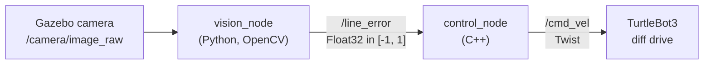

# TurtleBot3 Line Follower: Python vision + C++ control on ROS 2

A TurtleBot3 follows a blue line using a Python node and a C++ node working
together on ROS 2 Humble. Python handles the camera and computer vision; C++
handles the motion control. It runs end to end in Gazebo simulation.

This project is a building block: the vision → control pipeline built here is
meant to be reused as one part of a larger robotics task later. It is also my
first ROS 2 and C++ project, built step by step to learn, with AI as a tutor
(see [Versions](#versions)).

## How it works



**Vision (Python, `line_vision`)**
1. Convert the ROS image to OpenCV (`cv_bridge`).
2. Keep only the bottom 25% of the 640×480 frame (the floor just ahead of the robot).
3. Convert to HSV and keep blue pixels (H 100–130).
4. Find the line's centroid with image moments.
5. Publish the horizontal offset from the image center, normalized to [-1, 1]
   (-1 = far left, +1 = far right). Nothing is published when no line is visible.

**Control (C++, `line_control`)**
1. Turn the error into an angular velocity: ω = −k · error
   (line on the right → turn right).
2. Compute the wheel speeds with the differential-drive equations:

   $$v_R = v + \frac{\omega d}{2} \qquad v_L = v - \frac{\omega d}{2}$$

   where *d* is the distance between the wheels.
3. If either wheel would exceed its speed limit, scale **both** wheels by the
   same factor, so the turning radius stays the same and the robot only slows down.
4. Convert back to (v, ω) and publish `/cmd_vel` at 20 Hz.
5. Safety: if no `/line_error` arrives for 0.5 s (line lost, or the vision node
   crashed), publish a zero command and stop.

## Packages

| Package | Language | Contents |
|---|---|---|
| `line_vision` | Python (`ament_python`) | `vision_node`: camera → `/line_error` |
| `line_control` | C++ (`ament_cmake`) | `control_node`: `/line_error` → `/cmd_vel`; launch file and parameters |
| `line_vision_cpp` | C++ (`ament_cmake`) | `vision_node_cpp`: the same vision logic in C++ (see [Side experiment](#side-experiment-python-vs-c-vision-node)) |
| `line_follower_sim` | – (`ament_cmake`) | Gazebo world with the blue line course, its models, and the simulator launch file |

## Versions

The vision nodes exist in two versions, kept as git tags.

| | Version 1 (`v1`) | Version 2 (`v2`, current `main`) |
|---|---|---|
| Written by | me, with AI (Claude) as a tutor: step-by-step guidance, code review, and fixes to my C++ vision node draft | AI (Claude), on top of version 1 |
| Purpose | the line follower itself | measuring it for the [side experiment](#side-experiment-python-vs-c-vision-node) |
| Line detection and steering | ✓ | same logic, same output |
| Debug windows | always on | `show_debug` parameter (default on) |
| Per-stage timing | – | `timing_csv` parameter (default off) |
| C++ image conversion | `toCvCopy` | `toCvCopy`, or `toCvShare` with `zero_copy:=true` |

**Why two versions.** Version 1 is my implementation of the project. To answer
the side-experiment question, the vision nodes needed timers inside them and a
way to turn the display off, because drawing and `imshow` take longer than the
line detection itself and would hide the difference being measured. Those
changes were written by AI and kept separate as version 2, so version 1 stays
available as my original work.

**What changed in version 2** (`line_vision/vision_node.py`,
`line_vision_cpp/src/vision_node.cpp`):
- timestamps at four points of each frame: convert, process, publish, display;
- the drawing code moved after the publish step, so display can be timed and
  switched off without affecting the steering output;
- the C++ node can skip copying the image (`toCvShare`);
- per-frame timings are written to a CSV when the node shuts down.

With default parameters both versions behave the same on the robot: same
`/line_error` values, same debug windows. `line_control` is identical in both.

```bash
git checkout v1    # my original version
git checkout main  # version 2
```

## Requirements

- Ubuntu 22.04, ROS 2 Humble, Gazebo Classic
- `turtlebot3`, `turtlebot3_simulations` (ROBOTIS): robot model and spawn launch files
- OpenCV and `cv_bridge` (installed with ROS 2 Humble desktop)

The simulation uses the **`waffle_pi`** model, because the Burger model in
`turtlebot3_simulations` has no camera. For `waffle_pi` the wheel distance is
*d* = 0.287 m; for a real Burger set `wheel_track` to 0.16 m.

## Build

```bash
cd ~/line_ws
source /opt/ros/humble/setup.bash
colcon build --symlink-install --cmake-args -DCMAKE_BUILD_TYPE=Release
source install/setup.bash
```

`-DCMAKE_BUILD_TYPE=Release` turns on compiler optimization for the C++ nodes;
without it colcon builds them unoptimized.

## Run

Terminal 1, the simulator (course with the blue line + TurtleBot3 `waffle_pi`):

```bash
ros2 launch line_follower_sim course2.launch.py
```

The launch file sets `TURTLEBOT3_MODEL=waffle_pi`, `GAZEBO_IP=127.0.0.1` (so
Gazebo works offline) and `QT_QPA_PLATFORM=xcb` (so the Gazebo window and the
camera work on Wayland desktops). Add `gui:=false` to run without the Gazebo
window.

Terminal 2, vision + control:

```bash
ros2 launch line_control line_follower.launch.py
```

To use the C++ vision node instead of the Python one, run the nodes separately
(never both vision nodes at once, they would both publish `/line_error`):

```bash
ros2 run line_vision_cpp vision_node_cpp
ros2 run line_control control_node
```

## Parameters

Set in `line_control/config/params.yaml`.

`control_node`

| Parameter | Default | Meaning |
|---|---|---|
| `linear_speed` | 0.1 | forward speed *v* (m/s) |
| `angular_gain` | 1.0 | *k* in ω = −k · error (rad/s per unit error) |
| `wheel_track` | 0.287 | wheel distance *d* (m) |
| `max_wheel_speed` | 0.26 | speed limit per wheel (m/s) |
| `line_timeout` | 0.5 | seconds without `/line_error` before stopping |

`vision_node` / `vision_node_cpp`

| Parameter | Default | Meaning |
|---|---|---|
| `show_debug` | `true` | show the camera and mask windows |
| `timing_csv` | `""` | if set, write per-frame stage timings to this CSV on shutdown |
| `zero_copy` (C++ only) | `false` | use `toCvShare` (no image copy) instead of `toCvCopy` |

## Side experiment: Python vs C++ vision node

Comparing languages was not the goal of this project. After the Python + C++
system worked, a follow-up question came up: how much does writing the vision
node in Python actually cost? To find out, the vision node was also written in
C++ with identical logic (both give bit-identical `/line_error` values) and the
two were measured side by side.

| Display off | Python | C++ |
|---|---|---|
| Work per frame (p50) | 1,459 µs | 491 µs |
| CPU at 30 fps | 12.2% | 2.9% |
| Round-trip latency (p50) | 3.33 ms | 1.13 ms |

The image-processing step itself costs the same in both languages (OpenCV does
the work either way); the difference comes from converting the image and
publishing the result. Full method, results and limitations:
[`docs/side_experiment_python_vs_cpp_vision.pdf`](docs/side_experiment_python_vs_cpp_vision.pdf).

> **Note:** the side-experiment report (the PDF above) was written with AI
> (Claude), from measurements of [version 2](#versions) of the code in this
> repository. The measurement tooling is not included.

## Status

- [x] Python vision node
- [x] C++ control node with differential-drive wheel-speed limiting
- [x] Launch file and parameter file
- [x] C++ vision node (side experiment)
- [x] Version 2: timing instrumentation for the side experiment
- [x] Simulation world packaged in this repository (`line_follower_sim`)
- [ ] Test on a real TurtleBot3
- [ ] Reuse as part of a larger task

## License and credits

The code in this repository is released under the [MIT License](LICENSE).

The simulation assets in `line_follower_sim` are not covered by that license
and belong to their original authors:

- **Course world and floor texture** (`worlds/turtlebot3_course2.world`,
  `models/turtlebot3_course/`): from the final project of the ROS course at
  King Mongkut's University of Technology North Bangkok (KMUTNB), 2023.
- **Charging dock with ArUco marker** (`models/charging_dock2_with_aruco/`):
  by Addison Sears-Collins (Automatic Addison).
- **TurtleBot3** robot models and spawn launch files: ROBOTIS
  (`turtlebot3_simulations`, Apache-2.0), used as a dependency.
